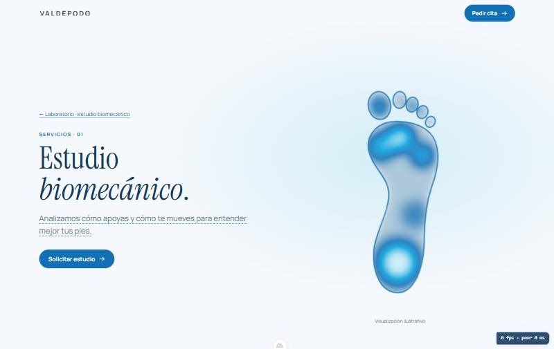
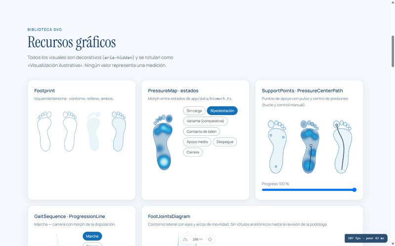
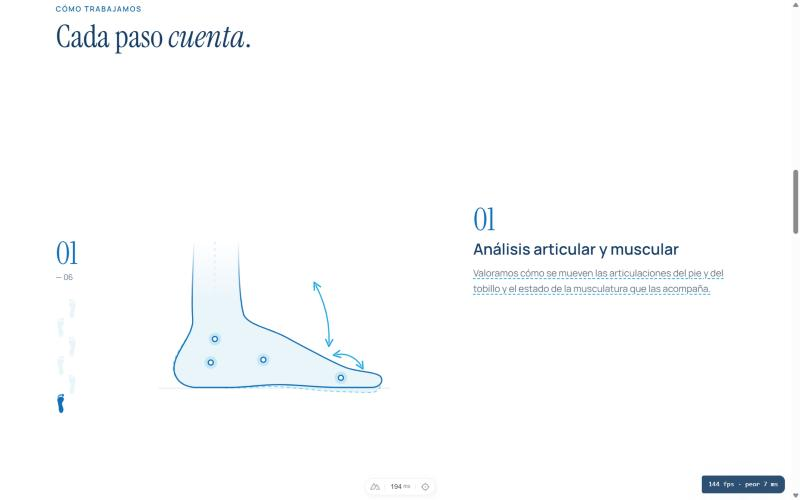
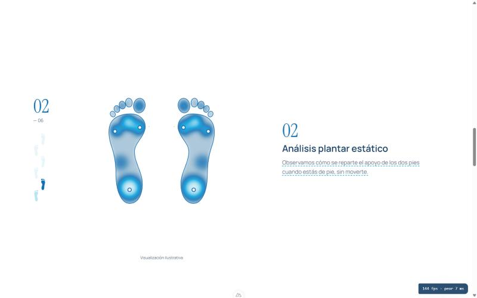
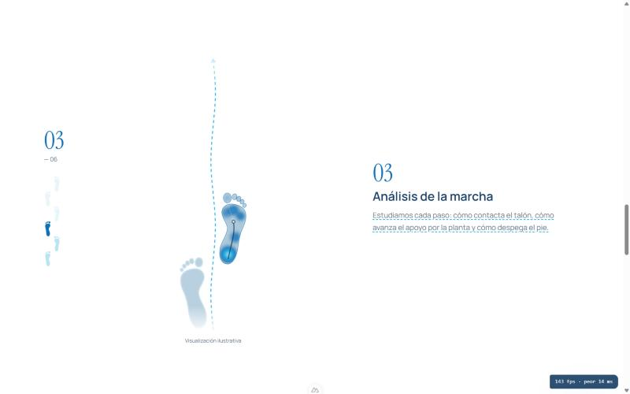
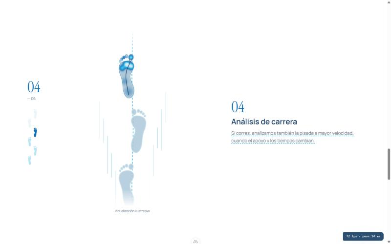
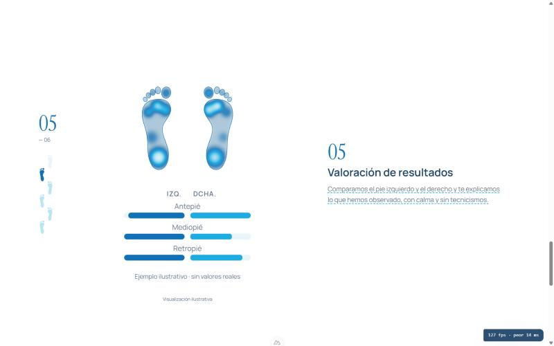
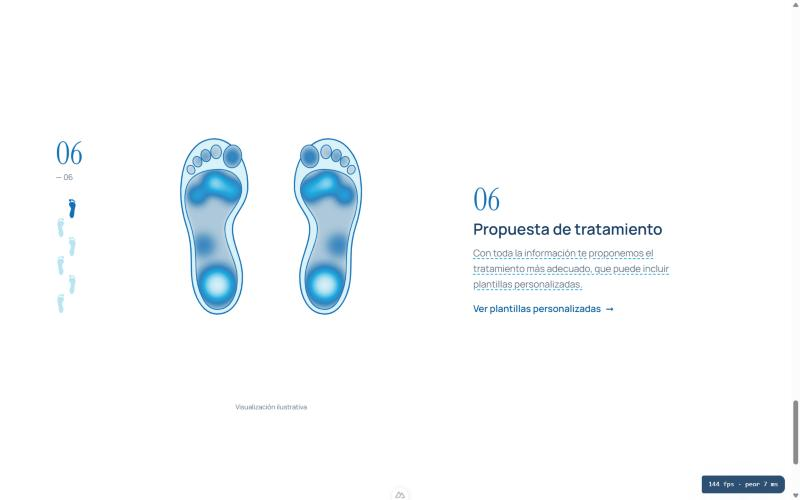
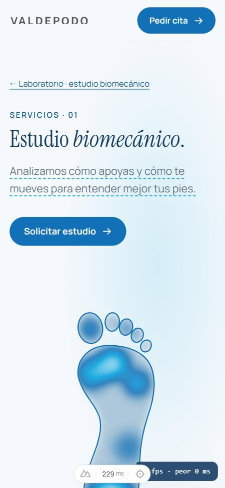
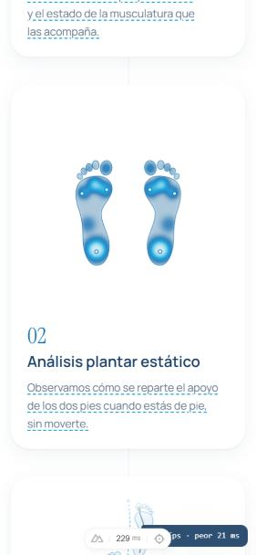

# FASE 3 — RECURSOS GRÁFICOS DEL ESTUDIO BIOMECÁNICO

> Informe del laboratorio (10/11/2026). Relacionado: [02-plan.md](02-plan.md) · [specs/04 §1](specs/04-servicios.md) · [specs/08 §3](specs/08-experiencias-3d.md) · [specs/09](specs/09-contenido-datos.md)
> Estado: **listo para la revisión visual (Gate 3).** Nada de esto se usa todavía fuera de `/_lab/biomecanico`.

## 1. Resumen

- Biblioteca SVG propia en `app/components/graphics/` (sin WebGL ni modelos externos): huella, mapa de presión, puntos de apoyo, centro de presiones, línea de progresión, secuencia de marcha, diagrama articular, el visual por fases y la sección completa.
- **Mapa de presión con la rampa de marca** (primary-strong → primary → cyan → ice-blue → blanco) hecho con un filtro SVG: los focos se suman como opacidad y `feComponentTransfer` los colorea. Los estados son datos (`app/data/biomech.ts`) y GSAP los interpola.
- **Secuencia de 6 fases** (spec 04 §1.3) en `/_lab/biomecanico`: visual sticky en ≥ 768 px (morph en escritorio, fundidos en tablet) y tarjetas verticales sin sticky en móvil.
- **Peso:** 11,6 KB gzip de JS + 2,0 KB gzip de CSS para todo el chunk (componentes, datos y la propia página de laboratorio). Límite del gate: 30 KB.
- **Decisión sobre `PressureShader.client`** (mejora opcional WebGL de la spec 04 §1.4): **no se hace**. El filtro SVG ya da un degradado continuo con la rampa de marca, y así la página no depende de Three.js.

## 2. Qué hay en el laboratorio

| Componente                   | Qué hace                                                                                                                                               |
| ---------------------------- | ------------------------------------------------------------------------------------------------------------------------------------------------------ |
| `Footprint` / `FootprintSvg` | Huella izquierda/derecha (la izquierda es el reflejo de la derecha). Variantes: contorno, relleno y ambos. Colores por variables CSS.                  |
| `PressureMap`                | 7 focos `{x, y, r, intensity}` + área de contacto, recortados con la silueta. Transiciones `morph`, `fade` o `instant`; "respiración" opcional (hero). |
| `SupportPoints`              | Talón y cabezas del 1.er y 5.º metatarsiano con pulso CSS.                                                                                             |
| `PressureCenterPath`         | Trayectoria talón → hallux con `stroke-dashoffset` y punto móvil; `progress` declarativo o bucle.                                                      |
| `ProgressionLine`            | Curva discontinua que pasa por una serie de puntos, con revelado y punta de flecha.                                                                    |
| `GaitSequence`               | 4 huellas alternas: contacto de talón → apoyo medio → despegue; la activa en azul y las anteriores en ice-blue. Marcha ↔ carrera con morph.            |
| `FootJointsDiagram`          | Contorno lateral con ejes y arcos de movilidad, y silueta fantasma que oscila. **Sin rótulos anatómicos.**                                             |
| `BiomechStage`               | Visual de una fase: tres capas (articular, par de huellas, marcha) que se funden en 400 ms.                                                            |
| `BiomechSequence`            | La sección: `<ol>` de fases, visual sticky + indicador "01 — 06" con rastro de huellas, tarjetas en móvil.                                             |
| `ContentValue`               | Muestra contenido `pending()` con subrayado discontinuo y la nota en el tooltip (fuera de producción).                                                 |

### Fases y visuales

| Fase                               | Visual                                                                                                                                       |
| ---------------------------------- | -------------------------------------------------------------------------------------------------------------------------------------------- |
| 01 · Análisis articular y muscular | Contorno lateral, ejes, arcos de movilidad.                                                                                                  |
| 02 · Análisis plantar estático     | Las dos huellas con el mapa en bipedestación y los puntos de apoyo.                                                                          |
| 03 · Análisis de la marcha         | Huellas alternas, centro de presiones en la huella activa, línea de progresión.                                                              |
| 04 · Análisis de carrera           | La misma secuencia se transforma: pasos más largos y estrechos, antepié más cargado, líneas de velocidad.                                    |
| 05 · Valoración de resultados      | Las huellas se reducen y aparecen barras izquierda/derecha **sin cifras ni unidades**, rotuladas "Ejemplo ilustrativo · sin valores reales". |
| 06 · Propuesta de tratamiento      | La silueta de una plantilla se dibuja bajo cada huella; enlace a Plantillas personalizadas.                                                  |

Entre 02, 05 y 06 los focos y las posiciones se interpolan (morph); entre 03 y 04, la disposición de la marcha. Entre grupos, fundido de 400 ms.

## 3. Capturas

| Hero (1440)                                     | Biblioteca (1440)                                           |
| ----------------------------------------------- | ----------------------------------------------------------- |
|  |  |

| 01                                               | 02                                               | 03                                               |
| ------------------------------------------------ | ------------------------------------------------ | ------------------------------------------------ |
|  |  |  |
| **04**                                           | **05**                                           | **06**                                           |
|  |  |  |

| Móvil 375 · hero                                     | Móvil 375 · tarjeta 02                                     |
| ---------------------------------------------------- | ---------------------------------------------------------- |
|  |  |

## 4. Comprobaciones

| Criterio (Gate 3)            | Resultado                                                                                                                                |
| ---------------------------- | ---------------------------------------------------------------------------------------------------------------------------------------- |
| Peso < 30 KB                 | ✅ 11,6 KB gzip (JS) + 2,0 KB gzip (CSS), medido en una build de producción (`nuxt build`).                                              |
| ≥ 55 fps en escritorio medio | 🟡 120-144 fps (peor fotograma 7-14 ms) en el equipo de desarrollo, con el medidor de la página. **Falta medir en un escritorio medio.** |
| Sin jank en móvil            | 🟡 Maquetación correcta a 375 px y sin scroll horizontal. **Falta probar en un móvil real** (el filtro SVG es lo más costoso).           |
| Rótulos ilustrativos         | ✅ "Visualización ilustrativa" junto a cada mapa; la comparativa no tiene cifras ni unidades.                                            |
| Reduced motion               | 🟡 Implementado (cambios inmediatos, sin bucles ni pulsos), pero no probado en el navegador con la preferencia activada.                 |
| Accesibilidad                | ✅ Fases en un `<ol>` con `h3`; visuales `aria-hidden`.                                                                                  |
| Lint, typecheck y tests      | ✅ 13 tests nuevos (`tests/unit/pressure.test.ts`): estados interpolables, focos dentro de la huella, rampa, fases y textos `pending`.   |

El medidor de FPS está fijo abajo a la derecha en `/_lab/biomecanico`: basta con recorrer la secuencia en el dispositivo que se quiera medir.

## 5. Contenido pendiente y avisos

- Los textos de las fases son **borradores neutros** envueltos en `pending()` (spec 09 §4); la clínica debe validarlos y confirmar qué fases incluye su estudio (spec 04 §1.3: no afirmar que todos los estudios incluyen todas).
- Los estados del mapa son **ilustrativos**: no representan patrones de referencia ni mediciones.
- El diagrama articular no lleva nombres anatómicos; si se quieren rótulos, debe revisarlos la podóloga (spec 01 §7).
- El enlace de la fase 06 apunta a `/servicios/plantillas-personalizadas`, que aún no existe (Fase 6): en desarrollo aparece un 404 en consola por el prefetch.

## 6. Decisiones técnicas

- **`@theme static`** en `main.css`: Tailwind emite todos los tokens como variables CSS para que los SVG los usen con `var()` aunque ninguna utilidad los referencie.
- **Sin niveles de `useDeviceTier`**: la secuencia es SVG y no depende de WebGL; se decide por anchura (`gsap.matchMedia`) y `prefers-reduced-motion`.
- **Parada baja de la rampa en primary-strong** en lugar de deep-blue: con deep-blue el área de contacto se veía gris sobre el fondo claro.
- Los atributos de los focos solo se fijan en el primer render; después los anima GSAP, para que Vue no pise la interpolación.
