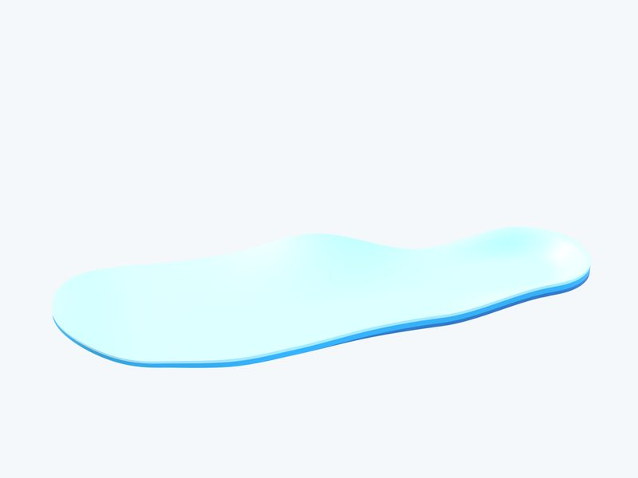
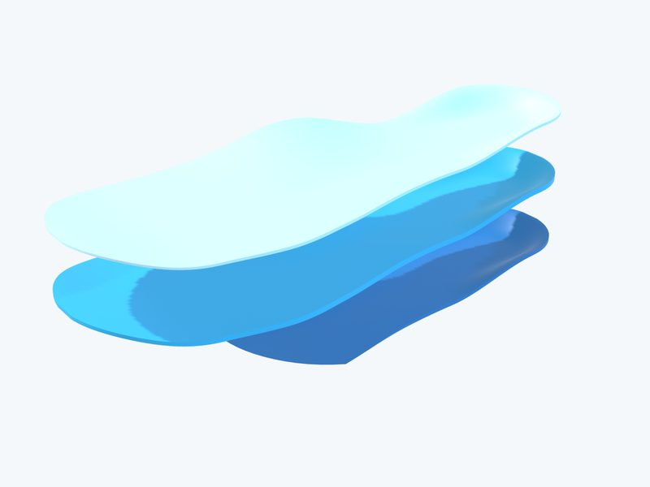
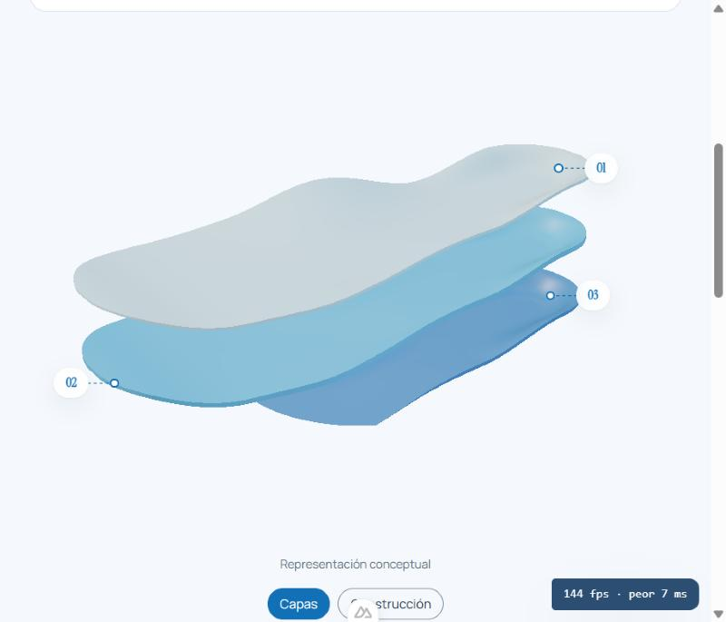
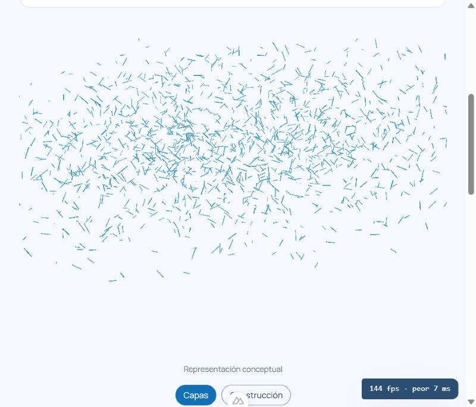
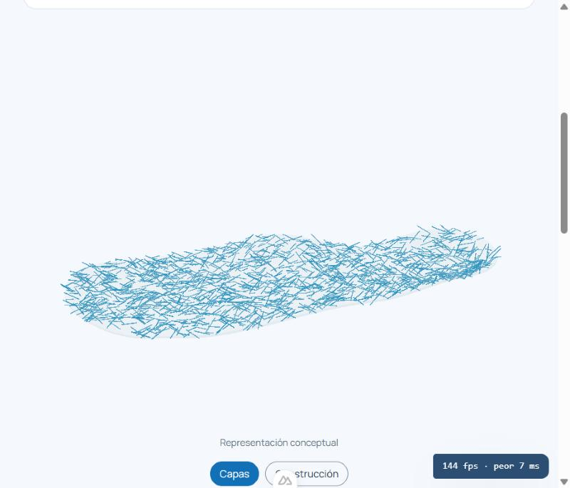
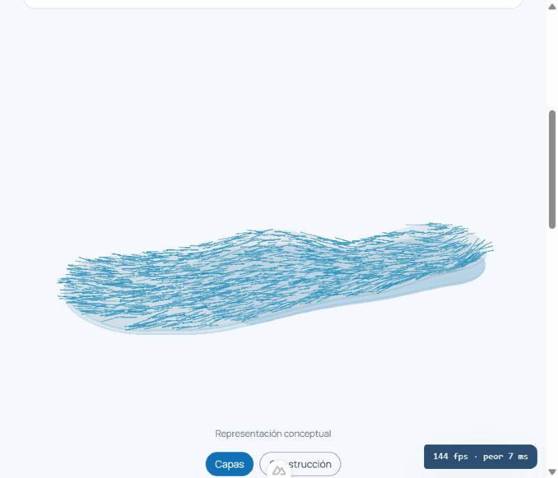
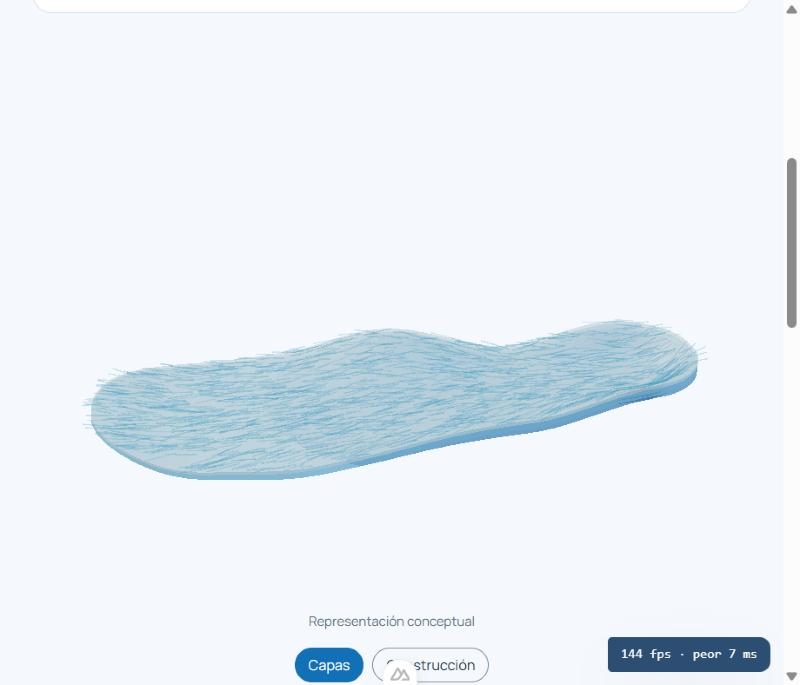

# FASE 4 — PLANTILLA CONCEPTUAL Y ANIMACIÓN DE FIBRAS

> Informe del laboratorio (10/11/2026). Relacionado: [02-plan.md](02-plan.md) · [specs/04 §2.2-2.3](specs/04-servicios.md) · [specs/08 §4](specs/08-experiencias-3d.md) · [3d-pipeline.md](3d-pipeline.md)
> Estado: **listo para la revisión visual (Gate 4).** Nada de esto se usa todavía fuera de `/_lab/plantilla`.

## 1. Resumen

- **Modelo propio y paramétrico**: `tools/blender/build_insole.py` genera la plantilla a partir de `tools/blender/config/insole.json` (v0.2.0) en tres capas cerradas `layer_top`, `layer_middle` y `layer_base`. Sin fuentes externas ni licencias de terceros.
- **GLB**: 113 KB y 24.086 triángulos tras meshopt (presupuesto: 500 KB y 60k). Pósters AVIF/WebP de 1600 y 800 px (completo y explotado) renderizados con Eevee, con el mismo encuadre que la web.
- **Escena web** (`InsoleScene.client` + `InsoleModel`): explosión con giro del modelo (10°) y órbita de cámara (−15°), etiquetas DOM proyectadas sobre cada capa y campo de fibras en la GPU (`InstancedBufferGeometry` + shader) con las 5 fases de la spec 08 §4.3.
- **Fibras**: 6.000 en nivel `full` y 1.500 en `lite`. Toda la animación ocurre en el shader a partir de `uProgress`: la CPU no actualiza ninguna matriz.
- **Sin atribuciones**: rótulos genéricos ("Capa superior", "Capa intermedia", "Base"), "Representación conceptual" bajo la escena y un test que falla si aparecen nombres de materiales o procesos.

## 2. Qué hay en el laboratorio

| Pieza                       | Qué hace                                                                                                                                           |
| --------------------------- | -------------------------------------------------------------------------------------------------------------------------------------------------- |
| `build_insole.py`           | Contorno 2D (talón y puntera redondeados, perfil de anchuras monótono), arco interno, copa de talón, elevación de la puntera y una malla por capa. |
| `config/insole.json`        | Forma, espesores, zonas, colores, encuadre compartido web/pósters y vistas de validación.                                                          |
| `tools/assets/posters.mjs`  | PNG de Blender → AVIF/WebP de 1600 y 800 px en `public/images/3d-fallbacks/insole/`.                                                               |
| `InsoleScene.client.vue`    | Lienzo TresJS, luces y cámara; emite `ready`, `stats` y los anclajes de las etiquetas.                                                             |
| `InsoleModel.vue`           | Carga el GLB, aplica `layerState()` a cada capa, monta el campo de fibras y proyecta los anclajes a coordenadas de pantalla.                       |
| `app/utils/insole-scene.ts` | Lógica pura (testeable en Node): fases, estado de las capas, atributos por fibra con semilla.                                                      |
| `app/utils/fiber-field.ts`  | Muestreo de la superficie superior y shader de las fibras.                                                                                         |
| `app/data/insole.ts`        | Capas y pasos del texto; descripciones en `pending()`.                                                                                             |
| `/_lab/plantilla`           | Parte A (explosión) y parte B (construcción). Scrub en ≥ 768 px, reproducción autónoma en móvil, modo manual con deslizadores y medidor de FPS.    |

### Fases de la construcción (spec 08 §4.3)

| `build`   | Fase       | Qué se ve                                                                       |
| --------- | ---------- | ------------------------------------------------------------------------------- |
| 0–0.2     | Dispersas  | Las fibras aparecen escalonadas en una nube por encima de la plantilla.         |
| 0.2–0.45  | Agrupación | Viajan hacia su punto de la superficie.                                         |
| 0.45–0.65 | Superficie | Se alinean con la dirección longitudinal; la capa superior aparece translúcida. |
| 0.65–0.85 | Volumen    | Las capas intermedia y base crecen en espesor.                                  |
| 0.85–1    | Plantilla  | Capas opacas y fibras desvanecidas.                                             |

## 3. Capturas

Pósters de Blender (los que ve quien no carga WebGL, y el primer fotograma de todos los demás):

| Completa                                                | Explotada                                                |
| ------------------------------------------------------- | -------------------------------------------------------- |
|  |  |

Escena en vivo a 736 px (maquetación móvil, 1.500 fibras):

| Capas (explosión 1)                                | 0.30 · agrupación                                  | 0.55 · superficie                                  |
| -------------------------------------------------- | -------------------------------------------------- | -------------------------------------------------- |
|      |  |  |
| **0.75 · volumen**                                 | **0.95 · plantilla**                               |                                                    |
|  |  |                                                    |

## 4. Comprobaciones

| Criterio (Gate 4)                     | Resultado                                                                                                                                                                                                     |
| ------------------------------------- | ------------------------------------------------------------------------------------------------------------------------------------------------------------------------------------------------------------- |
| Presupuesto del GLB                   | ✅ 113 KB · 24.086 triángulos (límite 500 KB · 60k). `npm run 3d:check` en verde.                                                                                                                             |
| Fibras ≥ 55 fps en escritorio         | 🟡 144 fps de media, peor fotograma 7,1 ms y ningún fotograma > 20 ms recorriendo la construcción completa a 1440 × 900 con 6.000 fibras, en el equipo de desarrollo. **Falta medir en un escritorio medio.** |
| Fibras ≥ 30 fps en móvil medio        | 🟡 144 fps a 736 px con 1.500 fibras en el equipo de desarrollo. **Falta probar en un móvil real.**                                                                                                           |
| Sin materiales ni procesos atribuidos | ✅ Rótulos genéricos, "Representación conceptual" bajo la escena y test con una lista de términos prohibidos.                                                                                                 |
| Iteración de parámetros validada      | 🟡 Pendiente de la revisión visual. Ya corregido en esta iteración: el borde delantero de la base (ver §6).                                                                                                   |
| Fallback                              | ✅ Póster explotado con variante de 800 px y lista numerada de capas como equivalente accesible.                                                                                                              |
| Reduced motion                        | 🟡 Implementado (ScrollTrigger sin suavizado; en móvil, saltos directos al estado final sin animación), pero no probado en el navegador con la preferencia activada.                                          |
| Consola                               | ✅ Sin errores en `/_lab/plantilla`.                                                                                                                                                                          |
| Lint, typecheck y tests               | ✅ 15 tests en `tests/unit/insole-scene.test.ts`: fases, estado de las capas, atributos de las fibras, recuentos por nivel, coherencia contenido/configuración, términos prohibidos y borde de la base.       |

El medidor de FPS está fijo abajo a la derecha en `/_lab/plantilla`; para medir en otro equipo basta con recorrer la parte B (o usar el modo manual).

## 5. Contenido pendiente y avisos

- Las descripciones de las capas y los textos de los cinco pasos son `pending()`. Las capas solo se describen si la clínica confirma qué aporta cada una (spec 04 §2.2).
- **La construcción por fibras es una metáfora visual**, no un proceso de fabricación. Si el proceso real de la clínica no encaja con ella, se adapta o se elimina la parte B.
- La forma (3/4 de base, arco, copa de talón) es genérica: no representa ningún producto de la clínica.

## 6. Decisiones técnicas y cambios de esta iteración

- **Base con borde delantero curvo** (config v0.2.0). En la v0.1.0 la base terminaba en una fila recta de la rejilla y, al explotar, se veía como una cuña con una esquina en punta. Ahora el final de cada columna sigue `end − front_curve·v² − front_skew·v`: más adelantado en el centro y en el lado interno. El adelgazamiento se calcula respecto a ese borde local.
- **Encuadre compartido**: la cámara, el giro y la órbita salen de `insole.json → view`, de modo que los pósters de Blender y la escena coinciden en el fundido póster → lienzo.
- **Fibras en un único draw call** (`InstancedBufferGeometry`): posición inicial, final, dirección y retardo por instancia como atributos; el vértice interpola según `uProgress`.
- **Etiquetas en DOM, no en WebGL**: texto nítido, accesible y con la tipografía de la web. En móvil solo se muestra el número; el nombre está en la lista.

### Puntos abiertos para la revisión visual

- **Color póster ↔ escena**: los pósters de Eevee salen más saturados que la escena en vivo (la capa superior se ve gris clara en la web y cian en el póster). Conviene igualarlos antes de la integración, porque el fundido de póster a lienzo hace visible el salto.
- En la fase de agrupación (≈ 0.3), en la maquetación móvil, la nube de fibras toca los bordes del lienzo y se corta en línea recta. Se puede reducir la dispersión inicial en móvil.
