# FASE 5 — INTEGRACIÓN DE LAS EXPERIENCIAS 3D Y PROPUESTA VISUAL

> Informe (10/11/2026). Relacionado: [02-plan.md](02-plan.md) · [specs/02](specs/02-layout-global.md) · [specs/03](specs/03-home.md) · [specs/04](specs/04-servicios.md) · [specs/08](specs/08-experiencias-3d.md)
> Estado: **propuesta lista para la revisión de la dirección artística (Gate 5).** Todas las páginas llevan `noindex` y el contenido clínico sigue en `pending()`.

## 1. Resumen

- **Home en código real** (`/`): navbar, hero con el pie anatómico y su secuencia de scroll, y el fragmento de servicios. Valores, reseñas y CTA final llegan en la Fase 6.
- **Las tres experiencias montadas en sus páginas**: el pie en la Home, la secuencia biomecánica en `/servicios/estudio-biomecanico` y la plantilla por capas y fibras en `/servicios/plantillas-personalizadas`. Las tres siguen en `/_lab` para seguir validándolas.
- **Pie anatómico como prototipo marcado**: se usa el modelo de la Fase 2 con el aviso "Modelo provisional" (solo en desarrollo y previews) y la atribución CC BY 4.0, como pide la spec 03 si el Gate 2 está pendiente.
- **Pósters del pie por capa** generados con Blender (`npm run 3d:foot-posters`) con el mismo encuadre que la web.
- **Tipografía A/B** conmutable con `?tipo=b` (botón abajo a la izquierda, fuera de producción).
- **Páginas provisionales** para el resto de rutas de la navegación (Servicios, Conócenos, Contacto, Pedir cita y los otros tres servicios): no hay enlaces rotos y el prerender pasa.

## 2. Qué se ha hecho

| Pieza                                                            | Detalle                                                                                                                                                                                                                                                                                                      |
| ---------------------------------------------------------------- | ------------------------------------------------------------------------------------------------------------------------------------------------------------------------------------------------------------------------------------------------------------------------------------------------------------ |
| `SiteNavbar`                                                     | Fija; 88 → 68 px y fondo glass a partir de 24 px de scroll; transparente sobre el hero. Estado activo con punto cian. < 1024 px: menú a pantalla completa con foco atrapado, Esc, resto de la página `inert`, scroll bloqueado y cierre al navegar. Servicios es un enlace directo (sin submenú).            |
| `HomeHero`                                                       | Texto col 1-5 y modelo col 5-12 con solape. Controles de capa (Exterior · Músculos · Tendones · Huesos) y rotación por arrastre (±60°, vuelve al soltar con ratón) o por botones. Elementos flotantes: indicador de capa y puntos de presión. Atmósfera + `OrganicLines`.                                    |
| Secuencia de scroll                                              | ≥ 1024 px y nivel `full`: pin de 250 % con scrub 0,6. Tramos: exterior en 3/4 → músculos → huesos → el modelo se aparta y se desvanece. Las frases laterales cambian con el tramo. Tablet/`lite`: scrub corto sin pin. Móvil: sin scrub. `static`: pósters por capa.                                         |
| `FootAnatomy.client` (antes `…Lab`)                              | Encuadre y luces desde `tools/blender/config/foot-view.json`; GLB `full`/`lite` según el nivel. `FootAnatomyModel`: cambio de capa con fundido de 500 ms (inmediato con reduced motion).                                                                                                                     |
| `render_foot_posters.py`                                         | Reproduce la escena web en Blender (centrado, escala, rotación, papeles de cada capa, contorno fresnel) y renderiza un póster por capa. AVIF de 9 a 47 KB.                                                                                                                                                   |
| `HomeServices` + `ServiceGraphic`                                | Composición asimétrica (01 grande, 02 alta, 03 media, 04-05 filas). Recurso propio por servicio: mapa de presión, plantilla en capas, uña, huellas que crecen y puntos de control. Hover: escala 1,02, borde primary 40 %, "Ver servicio →" y el recurso se anima. En táctil se anima al entrar en viewport. |
| `InsoleStory`                                                    | La experiencia de la Fase 4, extraída del laboratorio a un componente: la usan la página de Plantillas y `/_lab/plantilla` (que añade el modo manual).                                                                                                                                                       |
| Páginas de servicio                                              | Estudio biomecánico: hero con mapa que respira, introducción, `BiomechSequence` y CTA. Plantillas: hero con el póster de la plantilla (un solo lienzo WebGL por página, spec 08 §1.2), `InsoleStory` y CTA.                                                                                                  |
| `CtaBlock`, `PendingBadge`, `ProposalToolbar`, `PagePlaceholder` | CTA final con rastro de huellas; aviso de recurso provisional; conmutador A/B; página provisional de la Fase 6.                                                                                                                                                                                              |
| Datos                                                            | `app/data/site.ts`, `services.ts` y `home.ts`, con `pending()` en ciudad, teléfono, Instagram, descripciones y frases.                                                                                                                                                                                       |

## 3. Capturas

| 1440 · tipografía A                                           | 1440 · tipografía B                                       |
| ------------------------------------------------------------- | --------------------------------------------------------- |
| 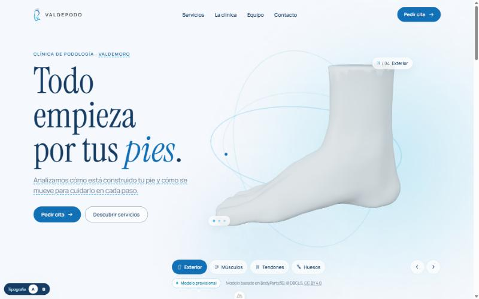                  | 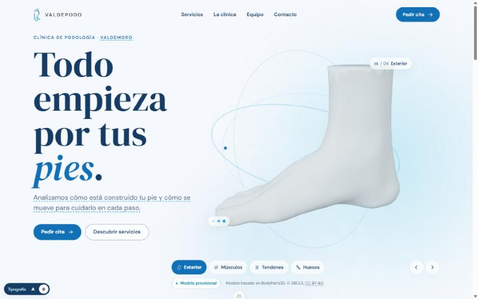              |
| **1440 · secuencia: músculos**                                | **1440 · secuencia: huesos**                              |
| 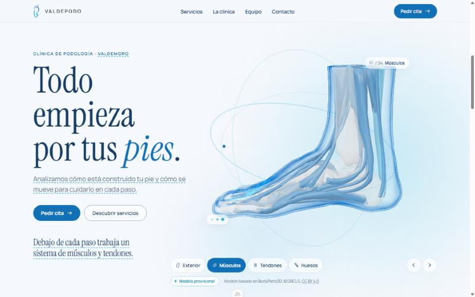    | 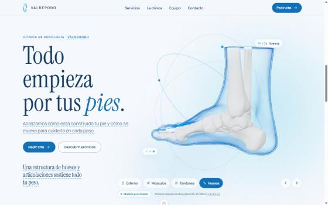    |
| **1440 · servicios (hover en 02)**                            | **1440 · Plantillas personalizadas**                      |
| 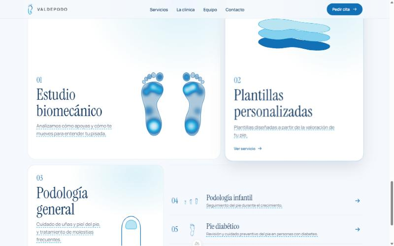 | 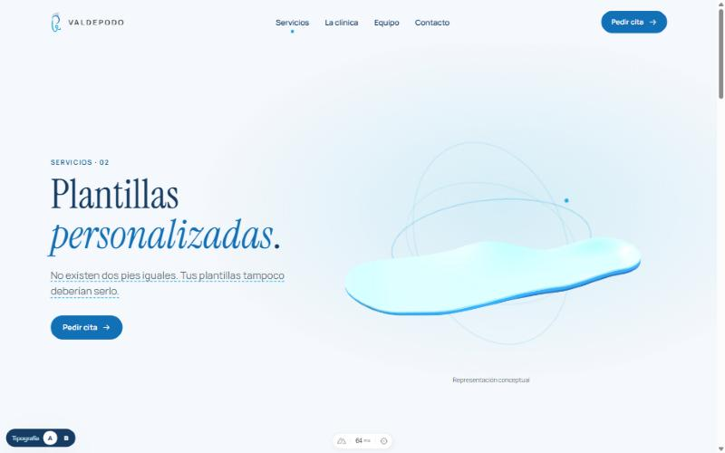 |

| 768                                         | 390                                         | 390 · menú                                   | 390 · servicios                                        |
| ------------------------------------------- | ------------------------------------------- | -------------------------------------------- | ------------------------------------------------------ |
| 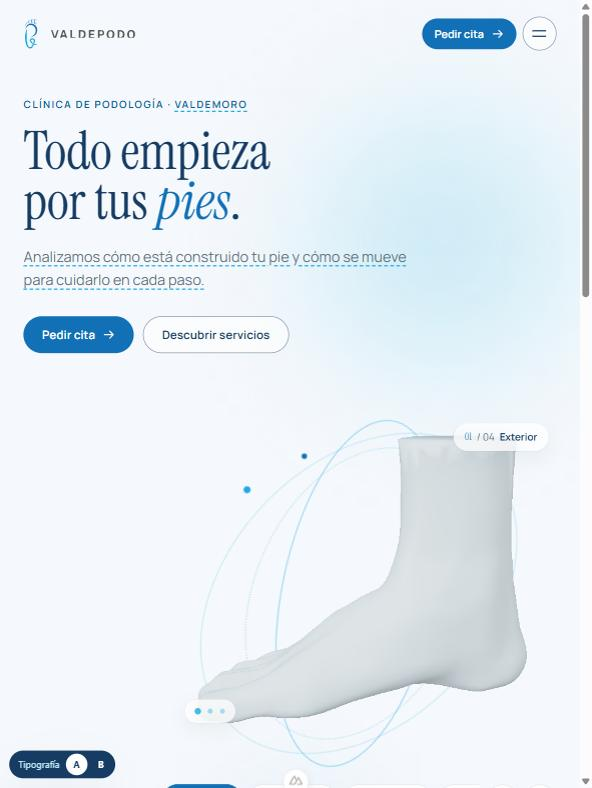 | 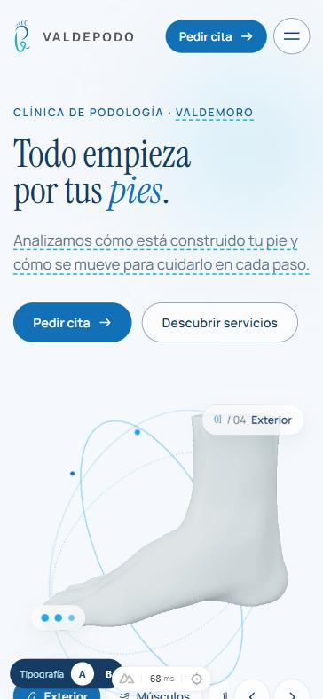 | 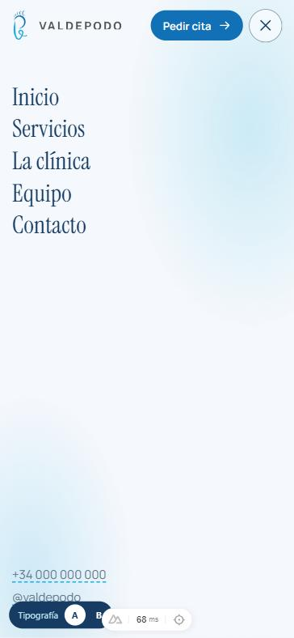 | 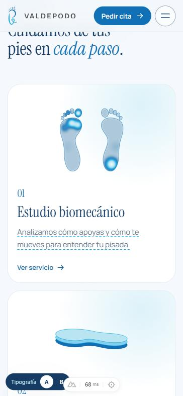 |

Pósters del pie (nivel `static`, reduced motion y primer fotograma):

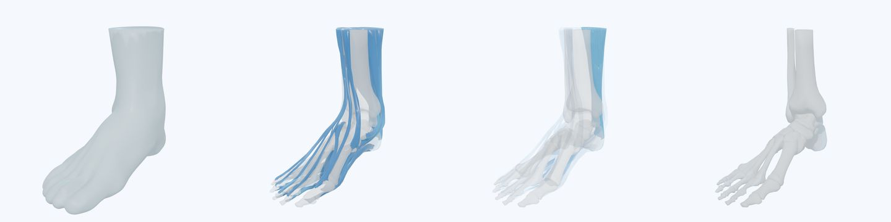

## 4. Comprobaciones

| Criterio (Gate 5)                    | Resultado                                                                                                                                                                                                            |
| ------------------------------------ | -------------------------------------------------------------------------------------------------------------------------------------------------------------------------------------------------------------------- |
| Aprobación de la dirección artística | ⏳ Pendiente de la revisión (color, tipografía A/B, navbar, hero, 3D, botones, fondos y animación).                                                                                                                  |
| Lighthouse móvil de la Home ≥ 85     | ⏳ **No medido.** Datos de la build: 141 KB gzip de JS inicial (Vue, Nuxt, GSAP) + 7 KB de CSS; el chunk de three/TresJS (223 KB gzip) no se precarga y solo se pide al acercarse el modelo con el navegador ocioso. |
| Sin errores de hidratación           | ✅ Sin avisos en consola en carga completa (`/` y `/?tipo=b`) ni al navegar.                                                                                                                                         |
| Navegación sin triggers huérfanos    | ✅ Navegación cliente Home → Biomecánico → Plantillas → Home → Contacto → Home → Biomecánico: el número de ScrollTriggers por página es siempre el mismo (2 · 7 · 2 · 0) y no quedan `pin-spacer` al salir.          |
| Sin scroll horizontal                | ✅ Comprobado a 390, 768 y 1440 px.                                                                                                                                                                                  |
| Prerender                            | ✅ `nuxt build`: 10 rutas prerenderizadas, sin enlaces rotos.                                                                                                                                                        |
| Lint, typecheck y tests              | ✅ 57 tests (10 nuevos en `tests/unit/home.test.ts`: secuencia, rotación continua, capas, encuadre compartido, pósters por capa, servicios y rutas con página).                                                      |
| Reduced motion                       | 🟡 Implementado (nivel `static`: pósters por capa, sin pin, sin pulsos ni órbitas, cambios de capa inmediatos), sin probar en el navegador con la preferencia activada.                                              |

## 5. Decisiones y puntos abiertos

- **Rotación inicial 0,8 rad** (vista 3/4 sobre el dorso). Con −0,6 (la del laboratorio) el pie se veía de perfil.
- **Pin creado al montar** (no al cargar el modelo, spec 03 §6): el pin no depende del modelo y así no hay salto de maquetación cuando aparece.
- **Un único lienzo por página**: en Plantillas, el hero usa el póster de Blender con una flotación CSS. El 3D se reserva para la experiencia de capas y fibras.
- **Sin hotspots ni etiquetas anatómicas** en el hero: dependen de textos validados por la podóloga (`app/data/anatomy.ts`, Gate 2). La arquitectura de estados ya admite añadirlos.
- **Color póster ↔ escena**: en el pie, el contorno fresnel sale gris en Blender y cian en la web. Afecta solo a los pósters de capas internas (nivel `static`); el póster que se funde con el lienzo es el exterior, que sí coincide. Igual que en la plantilla (Fase 4).
- **Chunk de three/TresJS: 223 KB gzip** frente al objetivo de ≤ 200 KB (spec 08 §1.5). Se carga después del LCP; reducirlo exige importar three por módulos o dejar TresJS.
- **CSS con ámbito frente a utilidades de Tailwind**: el CSS `scoped` no va en una capa y gana a las utilidades (`hidden`, `lg:hidden`, `h-9`…). Tres errores de maquetación de esta fase venían de ahí; la regla es poner los `display` responsivos en media queries dentro del propio `<style scoped>`.
